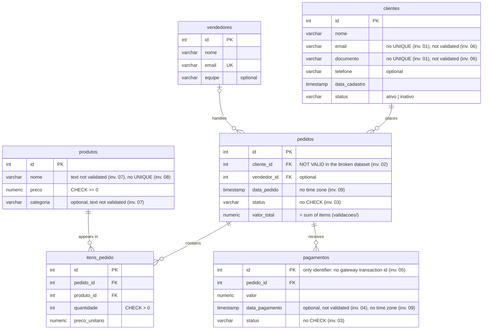

# 🔎 SQL Defect Investigation

[Português](README.md) · **English**


## Description

This repository simulates a sales CRM/ERP database with real-world data defects (duplicate customers, orphaned foreign keys, inconsistent statuses, invalid dates, duplicate payments, fake values in required fields, text with broken encoding, near-duplicates in the catalog and mixed time zones in dates) and documents the SQL investigations that find each one of them. It uses the same method applied when investigating production bugs: symptom → hypotheses → queries and evidence → root cause → impact → proposed fix.

This is not a SQL syntax exercise. The goal is to show how to use SQL to **find real defects** in a database whose data is already corrupted, the way it would happen while investigating a bug reported in production.

> **Related project:** the follow-up is [sql-performance-investigation](https://github.com/ThomasTDS/sql-performance-investigation), built on the same CRM/ERP with a realistic data volume. There the data is correct but the query is slow, and the evidence comes from execution plans (`EXPLAIN ANALYZE`). Its reports are written in Portuguese.

> **About the data:** the whole schema and all the data are fictional, created specifically for this portfolio project. No information from any current or past employer was used.

> **About the language:** the investigation reports, the SQL comments and the database identifiers (table and column names) are in Portuguese. This README is a full translation of the [Portuguese README](README.md).

---

## Data model

A sales CRM/ERP: customers place orders, which may be handled by a sales rep, contain items from the product catalog and receive payments.

Table names, in English: `clientes` = customers, `vendedores` = sales reps, `produtos` = products, `pedidos` = orders, `itens_pedido` = order items, `pagamentos` = payments.



The **inv. 01** to **inv. 09** notes mark the schema characteristic that is the root cause of each [investigated defect](#the-9-investigated-defects). For example, the missing `UNIQUE` on `email` and `documento` is what allows the duplicate customers of investigation 01.

---

## Project structure

```text
sql-defect-investigation/
├── .github/workflows/
│   └── ci.yml                 # CI: validation with embedded Postgres + Docker Compose
├── investigacoes/             # investigations
│   ├── 01-clientes-duplicados/
│   │   ├── README.md          # report: symptom → hypotheses → evidence → root cause → fix
│   │   ├── exploracao.sql     # queries in the order they were used
│   │   ├── deteccao.sql       # final detection query (run by the CI)
│   │   └── resultado-esperado.json  # result of each query in the report (test reference)
│   ├── 02-fk-orfa/            # same structure
│   ├── 03-status-inconsistente/   # same structure
│   ├── 04-data-invalida/          # same structure
│   ├── 05-pagamento-duplicado/    # same structure
│   ├── 06-dados-de-mentira/       # same structure
│   ├── 07-codificacao-quebrada/   # same structure
│   ├── 08-duplicidade-aproximada/ # same structure
│   └── 09-fuso-horario/           # same structure
├── validacoes/                # value consistency rules (total, payment, catalog)
├── sql/
│   ├── 01_schema.sql          # DDL: tables, FKs, constraints
│   ├── 02_seed_valido.sql     # clean dataset (control group)
│   └── 03_seed_quebrado.sql   # defects introduced on purpose, with comments
├── scripts/
│   ├── validate.js            # starts a real Postgres and validates the schema + both datasets
│   ├── relatorios.js          # checks that the reports still match the database
│   └── postgres-embarcado.js  # helpers shared by both scripts
├── docker-compose.yml         # ready-to-use Postgres, already loaded with the data
├── package.json
├── LICENSE
├── README.md                  # Portuguese
└── README.en.md               # English
```

---

## How to run

### Option 1 — Docker (recommended)

```bash
docker compose up -d --wait
```

This starts PostgreSQL 16 on port 5432, already loaded with the schema and both datasets (the files in `sql/` run automatically, in order, the first time the container starts). `--wait` only returns once the database has finished loading.

To open a SQL terminal on the database:

```bash
docker compose exec postgres psql -U postgres -d defect_investigation
```

To stop the database and delete the data (everything is reloaded from scratch on the next start):

```bash
docker compose down -v
```

### Option 2 — Local validation without Docker

```bash
npm install
npm run validate
```

This downloads a real PostgreSQL 16 binary, the same version used with Docker, with no need to install Docker. It then starts a temporary database, loads the schema and both datasets, and checks that every expected defect is found by the investigation queries, and that the "valid" dataset alone triggers none of them.

```bash
npm run relatorios
```

This runs each investigation's `exploracao.sql` and compares the result of every query with the folder's `resultado-esperado.json`, which holds the same numbers shown in the report. If the data changes and a report becomes outdated, this command fails and points to the investigation, query and row that changed.

---

## Continuous integration

On every push to `main` and on every pull request, GitHub Actions runs two jobs in parallel:

- **Validação (Postgres embarcado)** (validation with embedded Postgres): runs `npm run validate` and `npm run relatorios`, the same commands as Option 2.
- **Docker Compose:** starts the database with `docker compose up --wait`, checks that the schema and both datasets were loaded, and runs each investigation's `exploracao.sql`. This ensures that Option 1 works and that every query shown in the reports runs without errors.

The result of each check shows up as a table in the run summary, in the **Actions** tab on GitHub, with no need to open the logs.

Dependencies are kept up to date by **Dependabot** ([`.github/dependabot.yml`](.github/dependabot.yml)): once a month, it opens at most one PR for the npm dependencies and one for the CI actions, and both go through the same CI. Major versions of `embedded-postgres` are excluded, because they set the Postgres version of the local validation, which must stay the same as the one used with Docker.

---

## The 9 investigated defects

| # | Defect | Simulated real-world scenario | Investigation |
|---|--------|-------------------------------|---------------|
| 1 | Duplicate customers | Sign-up form submitted twice, with no unique constraint on email/document | [Report](investigacoes/01-clientes-duplicados/README.md) |
| 2 | Orphaned foreign key | Customer deleted directly in the database (support access), without handling the linked orders | [Report](investigacoes/02-fk-orfa/README.md) |
| 3 | Inconsistent status | Order marked "delivered" without an approved payment; order "cancelled" with the payment still "approved" | [Report](investigacoes/03-status-inconsistente/README.md) |
| 4 | Invalid date | Payment entered by hand during reconciliation with a mistyped date, earlier than the order itself | [Report](investigacoes/04-data-invalida/README.md) |
| 5 | Duplicate payment | The gateway resent the payment confirmation (webhook) and the application recorded both, with no idempotency key | [Report](investigacoes/05-pagamento-duplicado/README.md) |
| 6 | Fake values in required fields | In phone sales sign-ups, email and CPF (Brazilian taxpayer ID) are required, and the agent typed filler values when the customer did not provide them | [Report](investigacoes/06-dados-de-mentira/README.md) |
| 7 | Text with broken encoding (mojibake) | The catalog sync with the ERP read a UTF-8 file as Windows-1252 | [Report](investigacoes/07-codificacao-quebrada/README.md) |
| 8 | Near-duplicate in the catalog | The sales screen search is exact, did not find the product, and the sales rep created another one with a typo in the name | [Report](investigacoes/08-duplicidade-aproximada/README.md) |
| 9 | Mixed time zones in dates | The mobile app stores the order date in UTC, while the website and the payment gateway store Brasília time, in a column that does not keep the time zone | [Report](investigacoes/09-fuso-horario/README.md) |

The reports are in Portuguese.

### Key findings

| # | What the investigation found | Root cause |
|---|---|---|
| 1 | Customers 1 and 11 are the same person, registered 2min32s apart with the name retyped, which rules out a double click and points to the form being filled in again | The `clientes` table has no uniqueness constraint on email or document |
| 2 | Order 10 (R$ 99.90) points to a deleted customer and disappears from every report that `JOIN`s with `clientes` | The customer was deleted while the foreign key did not exist; the FK was later recreated as `NOT VALID` and never validated |
| 3 | A cancelled order with its payment still approved (no refund), a delivered order with no confirmed payment, and order 10 confirmed with no payment | Order status and payment status change independently, and the database enforces no rule on them |
| 4 | A payment dated 48h before its own order, at the exact same time of day, which skews the time-to-approval metric | Manual entry with a mistyped date, with no date validation and no record of where the entry came from |
| 5 | Order 2 has two identical approved payments, 4 seconds apart: the system records R$ 199.80 received for a single R$ 99.90 transaction at the gateway | The `pagamentos` table does not store the gateway transaction id, so a resent webhook becomes a new payment |
| 6 | Three sign-ups rejected by the credit check: two with the email `naotem@naotem.com` ("don't have one") and fake CPFs (which **pass** the check-digit test), and one with two CPF digits swapped | `NOT NULL` only ensures the field is not empty: nothing validates its content, and the form offers no "not provided" option |
| 7 | Products named like "Módulo de Relatórios" in the emails of 5 orders, while "Plano Básico Mensal" is still correct: the defect is in the data, not in how it is displayed | The ERP sync reads the UTF-8 file as Windows-1252; the reverse operation restores the original text exactly, which proves the diagnosis |
| 8 | "Consultoria Avulsa (hora)" and "Consutoria avulsa - hora" are the same service, with its sales split between the two. No exact comparison links them, but text similarity (`pg_trgm`) gives 0.808, and the extension's default threshold (0.3) would flag legitimate plans as duplicates | `produtos.nome` has no uniqueness constraint, and the exact search on the sales screen pushes the rep into creating the product again |
| 9 | Two orders placed through the app at 10:30 and 11:10 pm on Jan 31 show up in February, with the payment 2h55 "before" the order. Removing the 3-hour offset puts the payment back in the normal pattern (5 minutes later). January is R$ 149.80 below the real figure | The date columns are `timestamp without time zone` and do not keep the time zone, so UTC and Brasília time mix without the database noticing |

Each report ends with a proposed fix, tested on a disposable copy of the database but **not applied**: as in a real investigation, QA delivers evidence and a recommendation, and the decision to change the data belongs to the responsible team.

### How to reproduce an investigation

With the database running (Option 1), each `exploracao.sql` runs the report's queries in the same order as its steps:

```bash
docker compose exec -T postgres psql -U postgres -d defect_investigation < investigacoes/01-clientes-duplicados/exploracao.sql
```

Change the folder to run the other investigations.

### Implementation

Each defect is implemented and commented in `sql/03_seed_quebrado.sql`. Each investigation lives in `investigacoes/`, with a full report and the detection query (`deteccao.sql`), which the CI runs against both datasets. That way, what is documented is exactly what is tested.

Besides the 9 defects, the validation also checks value consistency rules (order total = sum of its items, approved payments = order total, and item price equal to the catalog price in the control dataset). The rules, and the reason for each one, are in [`validacoes/`](validacoes/README.md) (in Portuguese).

### When the data changes

The reports show real query results, so a change in `sql/` can make them outdated. When that happens, `npm run relatorios` fails (and so does the CI). The way forward is:

1. Fix the `README.md` of the flagged investigation with the new numbers.
2. Run `npm run relatorios:atualizar`, which rewrites the `resultado-esperado.json` files.
3. Check in the PR diff that the reference and the report show the same numbers.

---

## License

Distributed under the MIT license. See [LICENSE](LICENSE) for details.
