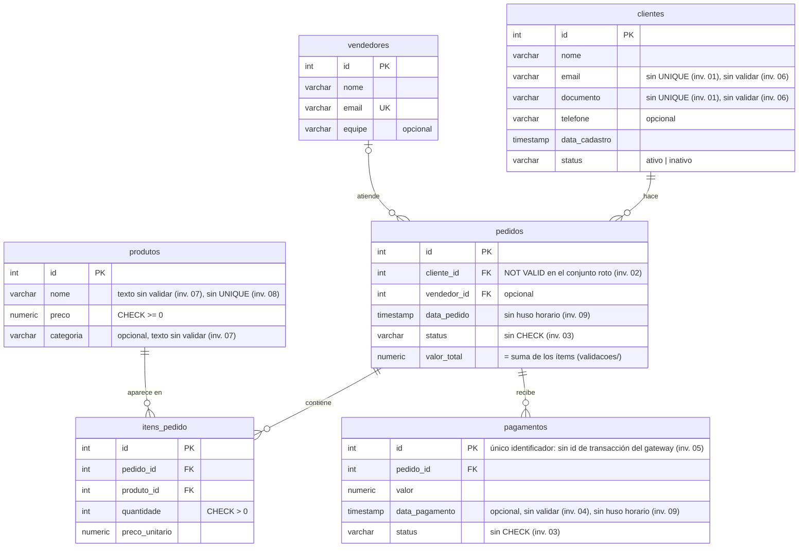

# 🔎 SQL Defect Investigation

[Português](README.md) · [English](README.en.md) · **Español**


## Descripción

Este repositorio simula una base de datos de CRM/ERP de ventas con defectos de datos reales (clientes duplicados, claves foráneas huérfanas, estados inconsistentes, fechas inválidas, pagos duplicados, valores falsos en campos obligatorios, texto con codificación rota, duplicados aproximados en el catálogo y husos horarios mezclados en las fechas) y documenta las investigaciones SQL que encuentran cada uno de ellos, con la misma metodología que se usa al investigar bugs de producción: síntoma → hipótesis → consultas y evidencias → causa raíz → impacto → corrección propuesta.

No es un ejercicio de sintaxis SQL. El objetivo es demostrar cómo usar SQL para **encontrar defectos reales** en una base con datos ya corrompidos, tal como ocurriría al investigar un bug reportado en producción.

> **Proyecto relacionado:** la continuación es [sql-performance-investigation](https://github.com/ThomasTDS/sql-performance-investigation), sobre el mismo CRM/ERP con un volumen realista de datos. Allí el dato es correcto, pero la consulta es lenta, y la evidencia viene de los planes de ejecución (`EXPLAIN ANALYZE`). Sus informes están en portugués.

> **Sobre los datos:** todo el esquema y todos los datos son ficticios, creados específicamente para este proyecto de portafolio. No se usó ninguna información de empleadores actuales o anteriores.

> **Sobre el idioma:** los informes de las investigaciones, los comentarios SQL y los identificadores de la base de datos (nombres de tablas y columnas) están en portugués. Este README es una traducción completa del [README en portugués](README.md).

---

## Modelo de datos

Un CRM/ERP de ventas: los clientes hacen pedidos, que pueden ser atendidos por un vendedor, contienen ítems del catálogo de productos y reciben pagos.

Nombres de las tablas, en español: `clientes` = clientes, `vendedores` = vendedores, `produtos` = productos, `pedidos` = pedidos, `itens_pedido` = ítems del pedido, `pagamentos` = pagos.



Las anotaciones **inv. 01** a **inv. 09** marcan la característica del esquema que es la causa raíz de cada [defecto investigado](#los-9-defectos-investigados). Por ejemplo, la falta de `UNIQUE` en `email` y `documento` es lo que permite los clientes duplicados de la investigación 01.

---

## Estructura del proyecto

```text
sql-defect-investigation/
├── .github/workflows/
│   └── ci.yml                 # CI: validación con Postgres embebido + Docker Compose
├── investigacoes/             # investigaciones
│   ├── 01-clientes-duplicados/
│   │   ├── README.md          # informe: síntoma → hipótesis → evidencia → causa raíz → corrección
│   │   ├── exploracao.sql     # consultas en el orden en que se usaron
│   │   ├── deteccao.sql       # consulta final de detección (ejecutada por la CI)
│   │   └── resultado-esperado.json  # resultado de cada consulta del informe (referencia de la prueba)
│   ├── 02-fk-orfa/            # misma estructura
│   ├── 03-status-inconsistente/   # misma estructura
│   ├── 04-data-invalida/          # misma estructura
│   ├── 05-pagamento-duplicado/    # misma estructura
│   ├── 06-dados-de-mentira/       # misma estructura
│   ├── 07-codificacao-quebrada/   # misma estructura
│   ├── 08-duplicidade-aproximada/ # misma estructura
│   └── 09-fuso-horario/           # misma estructura
├── validacoes/                # reglas de consistencia de valores (total, pago, catálogo)
├── sql/
│   ├── 01_schema.sql          # DDL: tablas, FKs, constraints
│   ├── 02_seed_valido.sql     # conjunto de datos limpio (control)
│   └── 03_seed_quebrado.sql   # defectos introducidos a propósito, comentados
├── scripts/
│   ├── validate.js            # levanta un Postgres real y valida el esquema + los dos conjuntos
│   ├── relatorios.js          # comprueba que los informes sigan coincidiendo con la base
│   └── postgres-embarcado.js  # funciones compartidas por los dos scripts
├── docker-compose.yml         # Postgres listo, ya cargado con los datos
├── package.json
├── LICENSE
├── README.md                  # portugués
├── README.en.md               # inglés
└── README.es.md               # español
```

---

## Cómo ejecutar

### Opción 1 — Docker (recomendado)

```bash
docker compose up -d --wait
```

Esto levanta un PostgreSQL 16 en el puerto 5432, ya cargado con el esquema y los dos conjuntos de datos (los archivos de `sql/` se ejecutan automáticamente, en orden, la primera vez que se inicia el contenedor). `--wait` solo devuelve la terminal cuando la base termina de cargarse.

Para abrir una terminal SQL en la base:

```bash
docker compose exec postgres psql -U postgres -d defect_investigation
```

Para detener la base y borrar los datos (en el próximo inicio, todo se recarga desde cero):

```bash
docker compose down -v
```

### Opción 2 — Validación local sin Docker

```bash
npm install
npm run validate
```

Esto descarga un binario real de PostgreSQL 16, la misma versión usada con Docker, sin necesidad de instalar Docker. Después, levanta una base temporal, carga el esquema y los dos conjuntos de datos, y confirma que las consultas de investigación encuentran cada defecto esperado, y que el conjunto "válido", por sí solo, no activa ninguna de ellas.

```bash
npm run relatorios
```

Esto ejecuta el `exploracao.sql` de cada investigación y compara el resultado de cada consulta con el `resultado-esperado.json` de la carpeta, que guarda los mismos números que muestra el informe. Si los datos cambian y algún informe queda desactualizado, este comando falla e indica la investigación, la consulta y la fila que cambiaron.

---

## Integración continua

En cada push a `main` y en cada pull request, GitHub Actions ejecuta dos jobs en paralelo:

- **Validação (Postgres embarcado)** (validación con Postgres embebido): ejecuta `npm run validate` y `npm run relatorios`, los mismos comandos de la Opción 2.
- **Docker Compose:** levanta la base con `docker compose up --wait`, comprueba que el esquema y los dos conjuntos de datos se hayan cargado y ejecuta el `exploracao.sql` de cada investigación. Esto garantiza que la Opción 1 funciona y que toda consulta mostrada en los informes se ejecuta sin errores.

El resultado de cada comprobación aparece en una tabla en el resumen de la ejecución, en la pestaña **Actions** de GitHub, sin necesidad de abrir los logs.

Las dependencias se mantienen actualizadas con **Dependabot** ([`.github/dependabot.yml`](.github/dependabot.yml)): una vez al mes, abre como máximo un PR para las dependencias de npm y otro para las actions de la CI, y ambos pasan por la misma CI. Las versiones major de `embedded-postgres` quedan fuera, porque definen la versión de Postgres de la validación local, que debe seguir siendo igual a la usada con Docker.

---

## Los 9 defectos investigados

| # | Defecto | Escenario real simulado | Investigación |
|---|---------|-------------------------|---------------|
| 1 | Clientes duplicados | Formulario de registro enviado dos veces, sin restricción única en email/documento | [Informe](investigacoes/01-clientes-duplicados/README.md) |
| 2 | Clave foránea huérfana | Cliente eliminado directamente en la base (acceso de soporte), sin tratar los pedidos vinculados | [Informe](investigacoes/02-fk-orfa/README.md) |
| 3 | Estado inconsistente | Pedido marcado como "entregado" sin pago aprobado; pedido "cancelado" con el pago todavía "aprobado" | [Informe](investigacoes/03-status-inconsistente/README.md) |
| 4 | Fecha inválida | Pago registrado a mano en la conciliación con la fecha mal escrita, anterior al propio pedido | [Informe](investigacoes/04-data-invalida/README.md) |
| 5 | Pago duplicado | El gateway de pago reenvió la confirmación (webhook) y la aplicación registró las dos, sin clave de idempotencia | [Informe](investigacoes/05-pagamento-duplicado/README.md) |
| 6 | Valores falsos en campos obligatorios | En el registro por televentas, el email y el CPF (identificación fiscal brasileña) son obligatorios, y el agente escribió valores de relleno cuando el cliente no los proporcionó | [Informe](investigacoes/06-dados-de-mentira/README.md) |
| 7 | Texto con codificación rota (mojibake) | La sincronización del catálogo con el ERP leyó un archivo UTF-8 como Windows-1252 | [Informe](investigacoes/07-codificacao-quebrada/README.md) |
| 8 | Duplicado aproximado en el catálogo | La búsqueda de la pantalla de ventas es exacta, no encontró el producto, y el vendedor registró otro con el nombre mal escrito | [Informe](investigacoes/08-duplicidade-aproximada/README.md) |
| 9 | Husos horarios mezclados en las fechas | La aplicación móvil guarda la fecha del pedido en UTC, mientras que el sitio web y el gateway de pago guardan la hora de Brasilia, en una columna que no conserva el huso horario | [Informe](investigacoes/09-fuso-horario/README.md) |

Los informes están en portugués.

### Principales hallazgos

| # | Qué encontró la investigación | Causa raíz |
|---|---|---|
| 1 | Los clientes 1 y 11 son la misma persona, registrados con 2min32s de diferencia y el nombre reescrito, lo que descarta un doble clic y apunta a que el formulario se volvió a llenar | La tabla `clientes` no tiene ninguna restricción de unicidad en email ni en documento |
| 2 | El pedido 10 (R$ 99,90) apunta a un cliente eliminado y desaparece de todo informe que hace `JOIN` con `clientes` | El cliente se eliminó mientras la clave foránea no existía; después se recreó como `NOT VALID` y nunca se validó |
| 3 | Un pedido cancelado con el pago todavía aprobado (sin reembolso), un pedido entregado sin pago confirmado y el pedido 10 confirmado sin pago | El estado del pedido y el del pago cambian de forma independiente, y la base no aplica ninguna regla sobre ellos |
| 4 | Un pago fechado 48 h antes de su propio pedido, exactamente a la misma hora del día, lo que distorsiona el indicador de tiempo hasta la aprobación | Registro manual con la fecha mal escrita, sin validación de fechas ni registro del origen |
| 5 | El pedido 2 tiene dos pagos aprobados idénticos, con 4 segundos de diferencia: el sistema registra R$ 199,80 recibidos para una única transacción de R$ 99,90 en el gateway | La tabla `pagamentos` no guarda el id de la transacción del gateway, así que un webhook reenviado se convierte en un pago nuevo |
| 6 | Tres registros rechazados en el análisis de crédito: dos con el email `naotem@naotem.com` ("no tiene") y CPF falsos (que **pasan** la prueba del dígito verificador), y uno con dos dígitos del CPF intercambiados | `NOT NULL` solo garantiza que el campo no esté vacío: nada valida su contenido, y el formulario no ofrece la opción "no informado" |
| 7 | Productos con nombres como "Módulo de Relatórios" en los emails de 5 pedidos, mientras que "Plano Básico Mensal" sigue correcto: el defecto está en el dato, no en cómo se muestra | La sincronización con el ERP lee el archivo UTF-8 como Windows-1252; la operación inversa devuelve exactamente el texto original, lo que prueba el diagnóstico |
| 8 | "Consultoria Avulsa (hora)" y "Consutoria avulsa - hora" son el mismo servicio, con las ventas divididas entre los dos. Ninguna comparación exacta los relaciona, pero la similitud de texto (`pg_trgm`) da 0.808, y el límite predeterminado de la extensión (0.3) marcaría planes legítimos como duplicados | `produtos.nome` no tiene ninguna restricción de unicidad, y la búsqueda exacta de la pantalla de ventas empuja al vendedor a registrar el producto otra vez |
| 9 | Dos pedidos hechos por la aplicación a las 22:30 y 23:10 del 31/01 aparecen en febrero, con el pago 2h55 "antes" del pedido. Al descontar las 3 horas del huso horario, el pago vuelve al patrón normal (5 minutos después). Enero queda R$ 149,80 por debajo del valor real | Las columnas de fecha son `timestamp without time zone` y no conservan el huso horario, así que UTC y la hora de Brasilia se mezclan sin que la base lo note |

Cada informe termina con una corrección propuesta, probada en una copia desechable de la base, pero **no aplicada**: como en una investigación real, QA entrega evidencia y una recomendación, y la decisión de cambiar los datos corresponde al equipo responsable.

### Cómo reproducir una investigación

Con la base en funcionamiento (Opción 1), cada `exploracao.sql` ejecuta las consultas del informe en el mismo orden de sus pasos:

```bash
docker compose exec -T postgres psql -U postgres -d defect_investigation < investigacoes/01-clientes-duplicados/exploracao.sql
```

Basta cambiar la carpeta para ejecutar las demás investigaciones.

### Implementación

Cada defecto está implementado y comentado en `sql/03_seed_quebrado.sql`. Cada investigación está en `investigacoes/`, con un informe completo y la consulta de detección (`deteccao.sql`), que la CI ejecuta contra los dos conjuntos de datos. Así, lo que está documentado es exactamente lo que se prueba.

Además de los 9 defectos, la validación comprueba reglas de consistencia de valores (total del pedido = suma de sus ítems, pagos aprobados = total del pedido, y precio del ítem igual al del catálogo en el conjunto de control). Las reglas y el motivo de cada una están en [`validacoes/`](validacoes/README.md) (en portugués).

### Cuando los datos cambian

Los informes muestran resultados reales de las consultas, así que un cambio en `sql/` puede dejarlos desactualizados. En ese caso, `npm run relatorios` falla (y la CI también). El camino es:

1. Corregir el `README.md` de la investigación señalada con los números nuevos.
2. Ejecutar `npm run relatorios:atualizar`, que reescribe los archivos `resultado-esperado.json`.
3. Comprobar en el diff del PR que la referencia y el informe muestran los mismos números.

---

## Licencia

Distribuido bajo la licencia MIT. Consulta [LICENSE](LICENSE) para más detalles.
