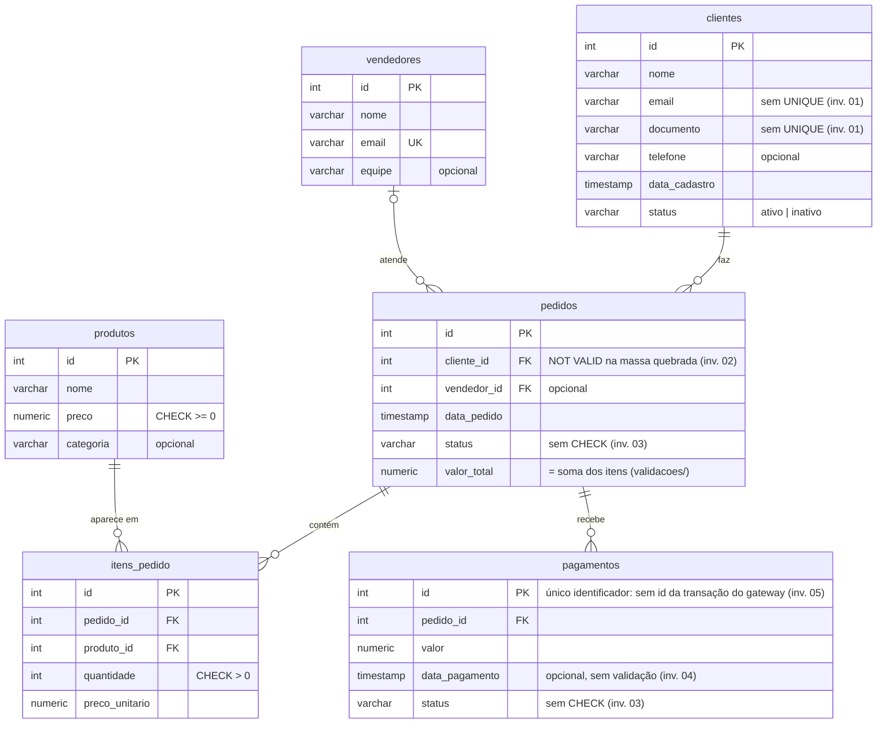

# 🔎 SQL Defect Investigation


## Descrição

Este repositório simula um banco de dados de CRM/ERP de vendas com defeitos de dados reais — clientes duplicados, foreign keys órfãs, status inconsistentes, datas inválidas e pagamentos em duplicidade — e documenta as investigações SQL que encontram cada um deles, com a mesma metodologia usada em investigação de bugs de produção: sintoma → hipóteses → queries e evidências → causa raiz → impacto → correção proposta.

Não é um exercício de sintaxe SQL: o objetivo é demonstrar a habilidade de usar SQL para **encontrar defeito real** num banco com dados já corrompidos, do jeito que aconteceria investigando um bug relatado em produção.

> **Nota sobre os dados:** todo o schema e os dados aqui são fictícios, criados especificamente para este projeto de portfólio. Nenhuma informação de empregador atual ou anterior foi usada.

---

## Modelo de dados

Um CRM/ERP de vendas: clientes fazem pedidos, que podem ser atendidos por um vendedor, contêm itens do catálogo de produtos e recebem pagamentos.



As anotações **inv. 01** a **inv. 05** marcam a característica do schema que é a causa raiz de cada [defeito investigado](#os-5-defeitos-investigados). Por exemplo, a falta de `UNIQUE` em `email` e `documento` é o que permite os clientes duplicados da investigação 01.

---

## Estrutura do Projeto

```text
sql-defect-investigation/
├── .github/workflows/
│   └── ci.yml                 # CI: validação com Postgres embarcado + Docker Compose
├── investigacoes/
│   ├── 01-clientes-duplicados/
│   │   ├── README.md          # relatório: sintoma → hipóteses → evidência → causa raiz → correção
│   │   ├── exploracao.sql     # queries na ordem em que foram usadas
│   │   └── deteccao.sql       # query final de detecção (executada pela CI)
│   ├── 02-fk-orfa/            # mesma estrutura
│   ├── 03-status-inconsistente/   # mesma estrutura
│   ├── 04-data-invalida/          # mesma estrutura
│   └── 05-pagamento-duplicado/    # mesma estrutura
├── validacoes/                # regras de consistência de valores (total, pagamento, catálogo)
├── sql/
│   ├── 01_schema.sql          # DDL: tabelas, FKs, constraints
│   ├── 02_seed_valido.sql     # massa de dados limpa (controle)
│   └── 03_seed_quebrado.sql   # defeitos introduzidos de propósito, comentados
├── scripts/
│   └── validate.js            # sobe um Postgres real e valida schema + as duas massas
├── docker-compose.yml         # Postgres pronto, já carregado com os dados
├── package.json
├── LICENSE
└── README.md
```

---

## Como rodar

### Opção 1 — Docker (recomendado)

```bash
docker compose up -d --wait
```

Isso sobe um PostgreSQL 16 na porta 5432 já com o schema e as duas massas de dados carregadas (os arquivos em `sql/` rodam automaticamente, em ordem, na primeira inicialização do container). O `--wait` só devolve o terminal quando o banco termina de carregar.

Para abrir um terminal SQL no banco:

```bash
docker compose exec postgres psql -U postgres -d defect_investigation
```

Para derrubar o banco e apagar os dados (na próxima subida, tudo é recarregado do zero):

```bash
docker compose down -v
```

### Opção 2 — Validação local sem Docker

```bash
npm install
npm run validate
```

Isso baixa um binário real do PostgreSQL 16, a mesma versão usada no Docker, sem precisar de Docker instalado. Em seguida, sobe um banco temporário, carrega o schema e as duas massas de dados, e confirma que cada defeito esperado é encontrado pelas queries de investigação — e que a massa "válida", sozinha, não aciona nenhuma delas.

---

## Integração contínua

A cada push na `main` e a cada pull request, o GitHub Actions roda dois jobs em paralelo:

- **Validação (Postgres embarcado):** executa `npm run validate`, os mesmos checks da Opção 2.
- **Docker Compose:** sobe o banco com `docker compose up --wait`, confere que o schema e as duas massas de dados foram carregados e executa o `exploracao.sql` de cada investigação. Isso garante que a Opção 1 funciona e que toda query mostrada nos relatórios roda sem erro.

O resultado de cada conferência aparece numa tabela no resumo da execução, na aba **Actions** do GitHub, sem precisar abrir os logs.

---

## Os 5 defeitos investigados

| # | Defeito | Cenário real simulado | Investigação |
|---|---------|------------------------|--------------|
| 1 | Clientes duplicados | Formulário de cadastro enviado duas vezes, sem constraint única em email/documento | [Relatório](investigacoes/01-clientes-duplicados/README.md) |
| 2 | Foreign key órfã | Cliente removido diretamente no banco (acesso de suporte), sem tratar os pedidos vinculados | [Relatório](investigacoes/02-fk-orfa/README.md) |
| 3 | Status inconsistente | Pedido marcado "entregue" sem pagamento aprovado; pedido "cancelado" com pagamento ainda "aprovado" | [Relatório](investigacoes/03-status-inconsistente/README.md) |
| 4 | Data inválida | Pagamento lançado à mão na conciliação com a data digitada errada, anterior ao próprio pedido | [Relatório](investigacoes/04-data-invalida/README.md) |
| 5 | Pagamento em duplicidade | O gateway reenviou a confirmação do pagamento (webhook) e a aplicação registrou as duas, sem chave de idempotência | [Relatório](investigacoes/05-pagamento-duplicado/README.md) |

### Principais achados

| # | O que a investigação encontrou | Causa raiz |
|---|---|---|
| 1 | Os clientes 1 e 11 são a mesma pessoa, cadastrados com 2min32s de diferença e o nome redigitado, o que descarta duplo clique e aponta para reenvio manual do formulário | A tabela `clientes` não tem nenhuma restrição de unicidade em e-mail ou documento |
| 2 | O pedido 10 (R$ 99,90) aponta para um cliente removido e some de todo relatório que faz `JOIN` com `clientes` | O cliente foi apagado num período sem a foreign key, que depois foi recriada como `NOT VALID` e nunca validada |
| 3 | Um pedido cancelado com o pagamento ainda aprovado (sem estorno), um pedido entregue sem pagamento confirmado e o pedido 10 confirmado sem pagamento | Os status de pedido e de pagamento mudam de forma independente, e o banco não tem nenhuma regra sobre eles |
| 4 | Um pagamento datado 48h antes do próprio pedido, com o mesmo horário dele, o que distorce o indicador de tempo até aprovação | Lançamento manual com a data digitada errada, sem validação de data nem registro da origem |
| 5 | O pedido 2 tem dois pagamentos aprovados idênticos, com 4 segundos de diferença: o sistema registra R$ 199,80 recebidos para uma única transação de R$ 99,90 no gateway | A tabela `pagamentos` não guarda o id da transação do gateway, então um webhook reenviado vira um pagamento novo |

Cada relatório termina com uma correção proposta, testada numa cópia descartável do banco, mas **não executada**: como numa investigação real, o QA entrega evidência e recomendação, e a decisão de mexer nos dados é do time responsável.

### Como reproduzir uma investigação

Com o banco no ar (Opção 1), cada `exploracao.sql` roda as queries do relatório na mesma ordem dos passos:

```bash
docker compose exec -T postgres psql -U postgres -d defect_investigation < investigacoes/01-clientes-duplicados/exploracao.sql
```

Basta trocar a pasta para rodar as outras investigações.

### Implementação

Cada defeito está implementado e comentado em `sql/03_seed_quebrado.sql`. Cada investigação fica em `investigacoes/`, com um relatório completo e a query de detecção (`deteccao.sql`), que a CI executa contra as duas massas de dados. Assim, o que está documentado é exatamente o que é testado.

Além dos 5 defeitos, a validação confere regras de consistência de valores (total do pedido = soma dos itens, pagamentos aprovados = total do pedido, e o preço do item igual ao do catálogo na massa de controle). As regras e o motivo de cada uma estão em [`validacoes/`](validacoes/README.md).

---

## Licença

Distribuído sob a licença MIT. Veja [LICENSE](LICENSE) para mais detalhes.
